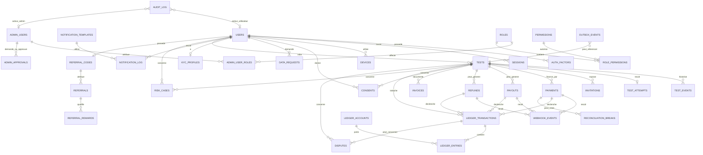
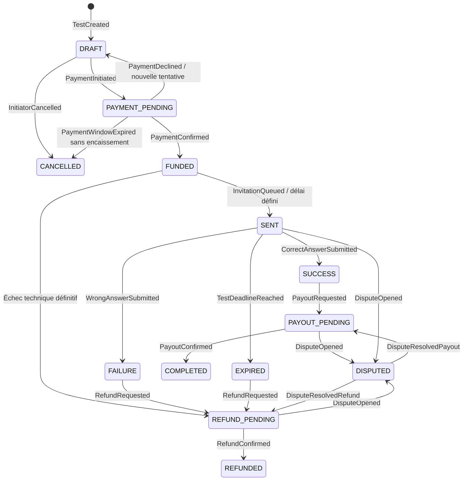
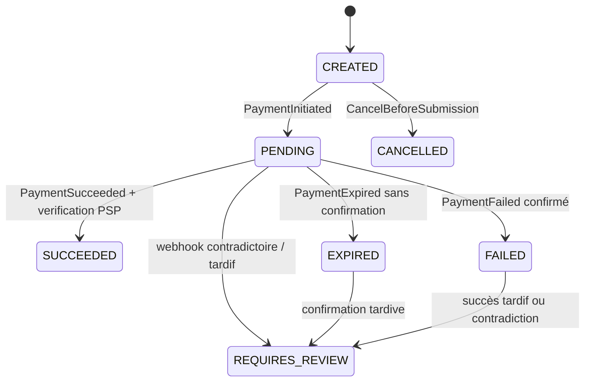

# TRUEBOND — Plan de conception du backend

**Statut :** proposition de conception — à valider avant toute implémentation  
**Périmètre :** analyse de `CLAUDE.md` et de `docs/cahier-des-charges.pdf` uniquement.  
**Phase actuelle :** planification ; aucun code applicatif n'est proposé ici.

## 0. Principes et décisions de conception proposées

1. **Monolithe modulaire NestJS + TypeScript strict**, PostgreSQL comme source de vérité, Prisma pour les opérations courantes et SQL ciblé pour les verrous et rapports. Cette approche suit `CLAUDE.md` et limite le coût opérationnel du MVP tout en gardant des frontières de modules propices à une extraction future.
2. **Ledger à double entrée, append-only**, pour chaque mouvement d'argent. Les états de paiement d'un prestataire ne sont pas assimilés à des écritures comptables ; les deux sont rapprochés par des identifiants stables.
3. **Aucun mouvement d'argent sur simple retour navigateur ou déclaration du client.** Seule une confirmation serveur vérifiée auprès du prestataire, ou une procédure de rapprochement approuvée, peut confirmer un encaissement, versement ou remboursement.
4. **Idempotence de bout en bout**, transactions SQL, contraintes d'unicité, outbox transactionnelle et workers rejouables. Les effets externes ne sont pas exécutés à l'intérieur d'une transaction SQL longue.
5. **Données sensibles séparées** : HMAC des numéros pour comparaison/indexation ; valeur chiffrée pour les usages qui exigent restitution ou notification ; jamais de numéro attendu dans les réponses du test.
6. **Sécurité des administrateurs renforcée dès le MVP** : RBAC, TOTP/SSO, moindre privilège, double approbation des actions financières sensibles et audit des accès aux données personnelles.
7. **Pays et devises configurables** : XAF pour le Cameroun et CAD pour le Canada sont cités dans `CLAUDE.md`. La disponibilité réelle des PSP, les règles légales et le traitement comptable doivent être confirmés avant activation d'un pays.
8. **Le mot « séquestre » est utilisé ici au sens fonctionnel de fonds suivis séparément dans le ledger.** Cela ne prouve pas, à lui seul, l'existence d'un séquestre juridique ou d'un compte bancaire séparé. Ce point doit être validé par un juriste et les partenaires financiers.

### Sources de cadrage

- `docs/cahier-des-charges.pdf` : produit, utilisateurs, test, anonymat, intégrations, exigences de paiement, administration, conformité et lancement.
- `CLAUDE.md` : architecture proposée, hypothèses de cycle de vie, modèle de données, flux, sécurité, CI/CD et infrastructure.

Les décisions ci-dessous sont des propositions de conception, pas des règles métier toutes explicitement validées par le propriétaire du produit.

---

## 1. Entités et relations

### 1.1 Entités proposées

#### Identité, authentification et données utilisateur

- **`users`** : compte utilisateur, numéro normalisé représenté par `phone_hmac` unique et `phone_enc` chiffré, pays, langue, statut, niveau KYC, dates de création/suppression logique. Le numéro ne doit pas être conservé en clair.
- **`auth_factors`** : facteurs d'authentification d'un utilisateur (`SMS_OTP`, puis éventuellement `TOTP`, `PASSKEY`), état et dates de vérification. Les secrets doivent être chiffrés.
- **`otp_challenges`** : challenge OTP, destinataire HMAC, hash/HMAC du code, finalité, expiration, compteur d'essais, statut, fournisseur et résultat d'envoi. Un code OTP brut ne doit jamais être journalisé.
- **`sessions`** : session et famille de refresh tokens, hash du token, expiration, révocation, détection de rejeu, dernière activité.
- **`devices`** : appareil associé à un utilisateur/session, identifiant applicatif pseudonymisé, plateforme, version, dates et indicateurs de risque. Éviter de collecter une empreinte intrusive inutile.
- **`consents`** : consentement explicite versionné et horodaté, utilisateur, test éventuel, type, version du texte, langue, canal et preuve technique. Un consentement ne doit pas être modifié rétroactivement ; conserver les événements de retrait.
- **`data_requests`** : demandes d'accès, rectification, export ou effacement, statut, échéances et décisions de traitement.
- **`kyc_profiles`** : niveau de vérification, prestataire, références externes, statut et dates ; minimiser les documents d'identité conservés.

#### Tests et invitations

- **`tests`** : test métier, code public opaque, initiateur, destinataire représenté par HMAC et valeur chiffrée si nécessaire, récompense, frais, devise, état, expiration, version optimiste et dates de transitions.
- **`test_attempts`** : tentative de réponse liée à un test ; contrainte unique sur `test_id` si la règle « une tentative par test » est confirmée. Stocker uniquement le HMAC de la réponse saisie et le résultat, jamais le numéro brut.
- **`test_events`** : historique append-only des changements d'état : état précédent/nouveau, acteur, motif, source, horodatage et identifiant de corrélation.
- **`invitations`** (recommandée comme entité distincte) : code/token d'invitation hashé, test, canal, expiration, usage, révocation et livraison. Permet de révoquer une invitation sans changer l'identifiant public du test.

#### Paiements et comptabilité

- **`payments`** : intention/encaissement initié auprès d'un PSP, type de moyen, fournisseur, référence externe, montant, devise, statut, clé d'idempotence et dates. Un test peut avoir plusieurs tentatives de paiement, mais un seul encaissement confirmé doit financer la même obligation.
- **`payouts`** : ordre de versement au bénéficiaire après réussite, montant brut/net, frais PSP, fournisseur, destination tokenisée/chiffrée, références et tentatives.
- **`refunds`** : ordre de remboursement de l'initiateur, montant, motif, lien au paiement d'origine, fournisseur, statut et références.
- **`webhook_events`** : enveloppe d'événement reçue d'un PSP, identifiant d'événement unique par fournisseur, résultat de vérification, date de réception/traitement et payload minimisé/chiffré selon les besoins de preuve. Les secrets et données de carte ne sont jamais conservés.
- **`ledger_accounts`** : comptes comptables par nature, propriétaire logique et devise ; comprend comptes de séquestre par test et comptes de contrepartie de règlement.
- **`ledger_transactions`** : groupe atomique d'écritures comptables, type d'opération, test et/ou paiement, clé d'idempotence unique, date et métadonnées non sensibles.
- **`ledger_entries`** : lignes append-only avec compte, sens débit/crédit, montant entier en unité mineure et devise. Chaque transaction doit s'équilibrer par devise ; aucune modification/suppression ordinaire.
- **`reconciliation_runs`** (recommandée) : exécution de rapprochement d'une période/fournisseur, périmètre, résultats et statut.
- **`reconciliation_breaks`** : écarts entre ledger, base interne et relevé/rapport PSP, montant, type d'écart, propriétaire et résolution.
- **`fee_schedules`** : versions datées des frais, règles par pays/devise/PSP/type d'opération et dates d'effet. Une opération conserve la version appliquée.
- **`invoices`** : numéro unique, bénéficiaire, transaction/test associé, montant et taxes éventuelles, devise, statut, clé objet PDF, hash du fichier et date d'émission.
- **`invoice_counters`** : séquence par entité légale/pays/année, transactionnelle afin de garantir l'unicité. La promesse de numérotation « sans trou » doit être conciliée avec les règles légales de facturation et les factures annulées.

#### Notifications, risque, litiges et audit

- **`notification_templates`** : modèle versionné par événement, canal et langue.
- **`notification_log`** : tentative de livraison, destinataire pseudonymisé, fournisseur, référence, statut, coût et dates. Le contenu doit être minimisé.
- **`notification_preferences`** (recommandée) : préférences utilisateur par canal et finalité, sans désactiver les messages indispensables à la sécurité/transaction si la loi le permet.
- **`risk_rules`** : règles de risque versionnées, seuils et statut d'activation.
- **`risk_cases`** : dossier d'examen de fraude, sujet, signaux, score explicable, statut, assignation et décision. Ne pas laisser une décision automatisée opaque être l'unique recours pour une mesure défavorable importante.
- **`blocklist`** : indicateurs bloqués (HMAC de numéro, appareil, compte ou empreinte de transaction), motif, provenance, expiration et auteur.
- **`disputes`** : litige lié à un test/transaction, motif, pièces référencées, état, responsable, échéances, décision et historique. Une ouverture doit geler les opérations automatiques pertinentes.
- **`audit_log`** : journal append-only des actions utilisateurs, administrateurs, workers et systèmes ; acteur, action, cible, horodatage, corrélation, IP pseudonymisée et métadonnées minimisées.
- **`outbox_events`** : événements à publier après commit SQL, statut de livraison, nombre d'essais et dates.
- **`idempotency_keys`** : clé, acteur, empreinte de requête, résultat stable, expiration et portée. Une même clé avec un payload différent doit être rejetée.

#### Administration, rôles, configuration et parrainage

- **`admin_users`** : identité d'administration, compte SSO, statut et facteurs forts. Peut être lié à un utilisateur interne, mais doit garder un périmètre d'accès distinct.
- **`roles`** : rôles nommés (`SUPPORT`, `FINANCE`, `RISK`, `AUDITOR`, `ADMIN`).
- **`permissions`** : permissions atomiques, par exemple consulter un utilisateur masqué, voir un numéro démasqué, initier un remboursement, approuver un remboursement, gérer les règles de risque.
- **`admin_user_roles`** : relation plusieurs-à-plusieurs entre administrateurs et rôles.
- **`role_permissions`** : relation plusieurs-à-plusieurs entre rôles et permissions.
- **`admin_approvals`** (recommandée) : approbation distincte d'une opération sensible, demandeur, approbateur, action, montant/seuil et décision. Le demandeur ne peut pas approuver sa propre demande.
- **`export_jobs`** : demande d'export, filtres, format, demandeur, statut, objet S3, expiration du lien et journalisation.
- **`countries`** : pays activés, devise par défaut, règles de routage et disponibilité des fonctions.
- **`feature_flags`** : activation contrôlée de fonctionnalités par environnement/pays/groupe.
- **`referral_codes`** : code de parrainage unique, propriétaire, dates, statut et conditions/version de campagne.
- **`referrals`** : relation parrain/parrainé, attribution, date, statut et preuve de qualification ; contrainte contre l'auto-parrainage et les doublons.
- **`referral_rewards`** (recommandée) : récompense due/émise/annulée, règle de campagne et lien vers l'écriture ledger si elle a une valeur monétaire. Les récompenses doivent rester désactivées tant que leurs conditions ne sont pas approuvées.

### 1.2 Relations principales

- Un utilisateur possède plusieurs facteurs d'authentification, sessions, appareils, consentements, demandes de données et profils KYC.
- Un utilisateur initiateur crée plusieurs tests. Un test possède zéro ou plusieurs tentatives de paiement, des événements, au plus une tentative de réponse si cette règle est confirmée, des consentements, des invitations, un compte de séquestre logique et des opérations financières.
- Un paiement confirmé peut financer un test. Un test peut avoir un versement ou plusieurs ordres de remboursement selon la politique de reprise/partiel à valider ; les contraintes métier doivent empêcher un cumul indu de remboursement et versement.
- Une transaction ledger possède plusieurs écritures ; chaque écriture appartient à un compte. Une opération métier ne doit créer qu'une seule transaction ledger par clé d'idempotence.
- Les webhooks sont dédupliqués par fournisseur + identifiant externe et peuvent référencer paiement, versement ou remboursement.
- Les factures se rapportent à une opération taxable/commerciale précise et ne doivent pas être confondues avec un reçu de paiement.
- Un litige ou un cas de risque peut référencer un utilisateur, test, paiement, versement, remboursement ou compte.
- Un administrateur reçoit plusieurs rôles ; un rôle possède plusieurs permissions. Une action financière sensible peut exiger plusieurs approbations distinctes.
- Un parrain peut avoir plusieurs filleuls via `referrals`, et une qualification peut déclencher une récompense seulement après contrôle antifraude.

### 1.3 Diagramme ER Mermaid proposé

**Note ER :** le diagramme montre les relations conceptuelles, pas toutes les clés étrangères polymorphes. Les références génériques d'audit, de risque, de webhook et de litige devront être modélisées explicitement (colonnes FK séparées, ou table de référence commune) pour préserver l'intégrité référentielle autant que possible.

---

## 2. Machines à états

### 2.1 Machine à états de `Test`

États proposés d'après `CLAUDE.md` :

- `DRAFT` : créé, non payé ; aucun fonds encaissé.
- `PAYMENT_PENDING` : une intention de paiement est en cours ; aucune confirmation financière définitive.
- `FUNDED` : encaissement confirmé et fonds affectés au compte de séquestre du test.
- `SENT` : invitation effectivement prise en charge pour livraison ; le délai de réponse démarre selon la règle à valider.
- `SUCCESS` : numéro saisi correct ; résultat métier fixé, versement à préparer.
- `FAILURE` : réponse incorrecte ; résultat métier fixé, remboursement à préparer selon la politique tarifaire.
- `EXPIRED` : échéance dépassée sans réponse ; remboursement à préparer selon la politique tarifaire.
- `PAYOUT_PENDING` : ordre de versement en cours ou en attente de confirmation.
- `REFUND_PENDING` : ordre de remboursement en cours ou en attente de confirmation.
- `COMPLETED` : versement confirmé et obligations financières du test soldées.
- `REFUNDED` : remboursement confirmé et obligations financières du test soldées.
- `DISPUTED` : opérations automatiques gelées le temps d'une instruction.
- `CANCELLED` : annulation avant financement ou selon une règle explicite de compensation.
- `PAYOUT_FAILED` / `REFUND_FAILED` : échec opérationnel nécessitant reprise ; de préférence, considérer ces états comme états d'opération (`payouts`/`refunds`) et garder le test dans `PAYOUT_PENDING` ou `REFUND_PENDING` tant que la résolution n'est pas définitive.

#### Transitions et déclencheurs

| État source | Événement déclencheur | État cible | Garde-fous et effets |
|---|---|---|---|
| Aucun | `TestCreated` | `DRAFT` | Utilisateur authentifié, destinataire distinct, montant/devise/limites valides, consentement enregistré ou exigé avant la mise en jeu. |
| `DRAFT` | `PaymentInitiated` | `PAYMENT_PENDING` | Idempotency-Key, intention PSP créée, aucune écriture d'encaissement à ce stade. |
| `DRAFT` | `InitiatorCancelled` | `CANCELLED` | Annulation autorisée uniquement avant financement. |
| `PAYMENT_PENDING` | `PaymentConfirmed` | `FUNDED` | Webhook authentifié + statut vérifié auprès du PSP ; transaction SQL atomique, ledger et outbox. |
| `PAYMENT_PENDING` | `PaymentDeclined` | `DRAFT` ou état d'échec de paiement | Recommandation : conserver l'état du test et exposer le paiement échoué séparément pour autoriser une nouvelle tentative sûre. |
| `PAYMENT_PENDING` | `PaymentWindowExpired` | `EXPIRED` ou `CANCELLED` | À distinguer de l'expiration d'un test déjà financé ; ne pas rembourser un encaissement qui n'est pas confirmé. |
| `FUNDED` | `InvitationQueued/Delivered` | `SENT` | Outbox, suivi de livraison ; le démarrage du délai doit être défini. Si l'envoi échoue définitivement, déclencher la politique de remboursement/renvoi. |
| `FUNDED` | `TechnicalFailureBeforeInvitation` | `REFUND_PENDING` | Compensation seulement si le fonds est confirmé et la politique le permet. |
| `SENT` | `CorrectAnswerSubmitted` | `SUCCESS` | Une seule tentative si validée ; vérification atomique avec verrou, code valide, OTP et consentement du testé. |
| `SENT` | `WrongAnswerSubmitted` | `FAILURE` | Même contrôle atomique ; ne pas révéler le numéro attendu. |
| `SENT` | `TestDeadlineReached` | `EXPIRED` | Worker avec verrouillage et reprise idempotente ; aucune réponse acceptée après l'échéance effective. |
| `SUCCESS` | `PayoutRequested` | `PAYOUT_PENDING` | Bénéficiaire et moyen de versement vérifiés ; fonds réservés comptablement, pas de finalité avant confirmation PSP. |
| `FAILURE` ou `EXPIRED` | `RefundRequested` | `REFUND_PENDING` | Calcul du montant remboursable selon politique versionnée ; frais et récompense séparés. |
| `PAYOUT_PENDING` | `PayoutConfirmed` | `COMPLETED` | Confirmation PSP vérifiée ; ledger de règlement une seule fois. |
| `REFUND_PENDING` | `RefundConfirmed` | `REFUNDED` | Confirmation PSP vérifiée ; ledger de règlement une seule fois. |
| `PAYOUT_PENDING` | `PayoutRejected/Timeout` | `PAYOUT_PENDING` + opération en erreur | Réessai avec backoff et limite, puis dossier de revue ; ne pas créer une nouvelle obligation comptable à chaque retry. |
| `REFUND_PENDING` | `RefundRejected/Timeout` | `REFUND_PENDING` + opération en erreur | Même stratégie, sans double remboursement. |
| État non final | `DisputeOpened` | `DISPUTED` | Geler versement/remboursement non irréversible ; si une opération PSP est déjà en vol, son résultat doit être réconcilié. |
| `DISPUTED` | `DisputeResolvedPayout` | `PAYOUT_PENDING` | Décision autorisée et auditée, approbation si seuil atteint. |
| `DISPUTED` | `DisputeResolvedRefund` | `REFUND_PENDING` | Décision autorisée et auditée, approbation si seuil atteint. |
| `DRAFT` | `InitiatorCancelled` | `CANCELLED` | Aucun effet financier. |

`COMPLETED`, `REFUNDED` et `CANCELLED` sont terminaux, sauf procédure de correction comptable distincte (contre-écriture, jamais réécriture de l'historique). Les événements et transitions doivent être vérifiés côté serveur dans une seule transaction SQL avec verrouillage optimiste/pessimiste adapté.

### 2.2 Machine à états de `Payment`

Le paiement d'encaissement doit avoir sa propre machine, distincte de celle du test. Les statuts PSP exacts varieront selon l'adaptateur ; l'API les normalise.

| État | Sens | Transitions principales / événements |
|---|---|---|
| `CREATED` | Intention interne créée | `PaymentInitiated` → `PENDING` ; annulation avant appel PSP → `CANCELLED`. |
| `PENDING` | En attente du client/PSP | `ProviderProcessing` reste `PENDING` ; `PaymentSucceeded` → `SUCCEEDED` ; `PaymentFailed` → `FAILED` ; `PaymentExpired` → `EXPIRED`. |
| `SUCCEEDED` | Encaissement confirmé côté PSP et revalidé | Écriture ledger unique, événement `PaymentConfirmed`. État final du paiement d'encaissement. |
| `FAILED` | Échec confirmé | État final de cette tentative ; une nouvelle tentative crée une nouvelle entité paiement. |
| `EXPIRED` | Intention expirée sans encaissement confirmé | État final de cette tentative, sauf événement tardif qui doit déclencher une procédure de rapprochement et non une transition aveugle. |
| `CANCELLED` | Annulée avant finalité | Pas d'écriture d'encaissement ; état final. |
| `REQUIRES_REVIEW` | Statut contradictoire, signature invalide ou événement tardif/ambigu | Mise en quarantaine, pas de mouvement financier automatique avant vérification. |

Les `payouts` et `refunds` doivent avoir des machines opérationnelles similaires (`CREATED`, `PENDING`, `SUCCEEDED`, `FAILED`, `REQUIRES_REVIEW`), car un paiement entrant réussi ne garantit pas qu'un versement ou un remboursement sorte avec succès.

---

## 3. Flux d'argent et écritures du ledger

### 3.1 Convention comptable proposée

- Tous les montants sont des entiers en unité mineure de la devise. Ne jamais utiliser de flottants pour les montants.
- Chaque `ledger_transaction` contient au moins deux écritures et est équilibrée **par devise**. Une devise ne se compense pas avec une autre.
- Convention simplifiée ci-dessous : **débit augmente un actif/une charge ; crédit augmente un passif/produit**, à confirmer avec le comptable selon le plan de comptes définitif. Les libellés sont logiques, pas un avis comptable ou juridique.
- Comptes conceptuels : `PSP_CLEARING` (créances/espèces en transit chez le PSP), `ESCROW:{test_id}` (passif dû au test/aux parties), `PLATFORM_FEE_REVENUE` (revenu de frais de service), `PSP_FEE_EXPENSE` (frais PSP), `PAYOUT_CLEARING` (montant dû/émis au bénéficiaire), `REFUND_CLEARING` (montant dû/émis à l'initiateur), `BANK_CASH` (trésorerie confirmée), `CUSTOMER_REFUND_PAYABLE` (passif de remboursement). Des sous-comptes de séquestre par test sont recommandés pour la traçabilité.
- Les écritures décrites ci-dessous sont des **écritures de principe**. Le traitement final dépendra du statut juridique des fonds, du PSP, des taxes, de la reconnaissance des revenus et de la comptabilité de l'entreprise.
- Un webhook dupliqué ne doit jamais produire une deuxième écriture. Toute correction s'effectue par une contre-écriture référencée, jamais par UPDATE/DELETE du ledger.

### 3.2 Création du test

1. L'utilisateur authentifié soumet le montant de récompense, le numéro du destinataire, la devise/pays et accepte la version de consentement applicable.
2. Le serveur valide le minimum (20 000 XAF selon le document), les plafonds, les pays activés, l'absence d'auto-test, la vérification du numéro de l'initiateur et les règles de risque.
3. Création du test en `DRAFT`, de l'enregistrement de consentement, de la clé d'idempotence et de l'événement d'audit.
4. **Écritures ledger : aucune**, car le test n'est pas encore financé. L'écriture d'une « promesse » de fonds serait un engagement non encaissé et doit rester séparée du ledger financier.

### 3.3 Paiement/encaissement de la récompense

1. Le client demande une intention de paiement ; le backend crée `payments(CREATED/PENDING)` et appelle l'adaptateur PSP via une opération idempotente.
2. Le PSP confirme ; le backend vérifie signature, événement unique, statut/ montant/devise/référence auprès du PSP et applique les contrôles anti-rejeu.
3. Dans une transaction SQL, il passe le paiement à `SUCCEEDED`, enregistre la transaction ledger équilibrée et ajoute l'événement outbox. Le test passe à `FUNDED` seulement si l'encaissement est complet et conforme.

**Écritures de principe à la confirmation d'un encaissement brut `R` :**

| Compte | Débit | Crédit |
|---|---:|---:|
| `PSP_CLEARING` | `R` | — |
| `ESCROW:{test_id}` (passif de fonds affectés au test) | — | `R` |

Si le PSP prélève immédiatement des frais d'encaissement `P`, enregistrer ces frais séparément sur preuve de règlement, sans réduire silencieusement la récompense promise :

| Compte | Débit | Crédit |
|---|---:|---:|
| `PSP_FEE_EXPENSE` | `P` | — |
| `PSP_CLEARING` | — | `P` |

Le coût du test (2 500 XAF) est actuellement ambigu : si le paiement total demandé est `R + F`, la répartition comptable de `R` et `F` doit être décidée explicitement. Ne pas assimiler les frais de service à une partie de la récompense.

### 3.4 Mise en séquestre et envoi de l'invitation

- L'allocation au compte logique `ESCROW:{test_id}` intervient après confirmation PSP, dans la même transaction SQL que le passage à `FUNDED`.
- L'envoi SMS/push est déclenché via l'outbox après commit ; il ne doit pas retarder ni annuler la transaction SQL.
- Le test passe à `SENT` selon la règle de déclenchement convenue (mise en file, acceptation fournisseur ou livraison confirmée). Le délai de 72 heures recommandé dans `CLAUDE.md` doit démarrer à un instant défini.
- Si l'invitation échoue définitivement, la règle de compensation doit être décidée : nouvelle tentative, autre canal, ou remboursement. Ne jamais supposer que l'envoi a réussi uniquement parce que le job a été mis en file.
- Aucun nouveau mouvement de ledger n'est nécessaire pour passer d'un état `FUNDED` à `SENT` si les fonds sont déjà affectés au compte de séquestre.

### 3.5 Réussite et versement au testé

1. Une réponse correcte est acceptée atomiquement une seule fois ; test → `SUCCESS`.
2. Le moyen de versement du bénéficiaire est collecté, vérifié et protégé ; l'API ne doit pas accepter un numéro arbitraire sans contrôles antifraude/KYC adaptés.
3. Création d'un `payout` unique et réservation du passif à verser ; test → `PAYOUT_PENDING`.
4. Le PSP reçoit une instruction idempotente ; le test ne passe à `COMPLETED` qu'après confirmation vérifiée.

**À la demande de versement, pour un montant dû `R` :**

| Compte | Débit | Crédit |
|---|---:|---:|
| `ESCROW:{test_id}` | `R` | — |
| `PAYOUT_CLEARING` (passif/ordre de versement en cours) | — | `R` |

**À la confirmation du versement :**

| Compte | Débit | Crédit |
|---|---:|---:|
| `PAYOUT_CLEARING` | `R` | — |
| `PSP_CLEARING` ou `BANK_CASH` (selon le règlement confirmé) | — | `R` |

Si des frais de versement `P` sont supportés par la plateforme : débit `PSP_FEE_EXPENSE` de `P`, crédit `PSP_CLEARING`/`BANK_CASH` de `P`. S'ils sont déduits de la récompense, il faut définir si le montant `R` est le montant brut ou le montant net promis ; cette politique ne peut pas rester implicite.

Si le versement échoue, l'ordre opérationnel reste en échec/en reprise et le passif ne doit pas disparaître. Selon le résultat réel du PSP, contre-passer la réservation et réaffecter le passif au séquestre ou à un compte de paiement à régulariser. Ne pas débiter de nouveau le séquestre à chaque retry.

### 3.6 Échec de réponse

Le test passe à `FAILURE`. Le cahier des charges dit « remboursement automatique à l'initiateur » ; `CLAUDE.md` suppose que les frais de service de 2 500 XAF restent acquis sauf défaillance technique. Ces deux propositions doivent être arbitrées.

**Si le montant `R` est entièrement remboursable :** mêmes écritures que le flux de remboursement ci-dessous, pour `R`.

**Si une part `F` est définitivement acquise à la plateforme et `R` correspond à la récompense séquestrée :** la comptabilisation de `F` dépend de ce qui a été encaissé au départ. Si `F` a été encaissé séparément et comptabilisé comme revenu acquis, ne pas le débiter du compte de séquestre. Si `F` fait partie d'un encaissement combiné, répartir dès l'encaissement entre passif de séquestre et produit/frais selon la politique approuvée. Ne jamais créer un revenu sans preuve d'encaissement et règle de reconnaissance approuvée.

### 3.7 Expiration sans réponse

1. Un worker sélectionne les tests `SENT` arrivés à échéance avec verrouillage (`FOR UPDATE SKIP LOCKED` ou équivalent), vérifie qu'aucune tentative acceptée n'existe et passe le test à `EXPIRED`.
2. Il crée un ordre de remboursement unique et passe à `REFUND_PENDING`.
3. Les écritures suivent le même schéma que l'échec, selon la politique de frais et de remboursement validée.
4. Les retards de worker ne doivent pas autoriser une réponse après `expires_at` ; la comparaison de l'échéance est appliquée aussi dans l'endpoint de réponse.

### 3.8 Remboursement à l'initiateur

1. Créer `refunds` lié au paiement initial, avec montant/motif/clés d'idempotence.
2. Réserver le montant remboursable en déplaçant le passif du compte séquestre vers `REFUND_CLEARING`.
3. Appeler le PSP ; vérifier la confirmation et rapprocher le remboursement de la référence d'encaissement d'origine.
4. À confirmation, solder `REFUND_CLEARING`. En cas d'échec, conserver l'obligation et réessayer ou créer une tâche manuelle ; ne pas considérer le remboursement comme exécuté.

**À la demande du remboursement d'un montant `A` :**

| Compte | Débit | Crédit |
|---|---:|---:|
| `ESCROW:{test_id}` | `A` | — |
| `REFUND_CLEARING` (passif de remboursement en cours) | — | `A` |

**À la confirmation du remboursement :**

| Compte | Débit | Crédit |
|---|---:|---:|
| `REFUND_CLEARING` | `A` | — |
| `PSP_CLEARING` / `BANK_CASH` | — | `A` |

Les frais PSP non récupérables liés au remboursement sont comptabilisés séparément. Il faut déterminer s'ils sont supportés par la plateforme ou déduits du montant rendu à l'initiateur ; par défaut recommandé pour la transparence produit : ne pas réduire le remboursement utilisateur sans règle affichée, consentie et juridiquement validée.

### 3.9 Frais de service et frais PSP

- **Frais de service `F`** : tarif versionné par pays/devise et date d'effet. Le document indique 2 500 FCFA par test, mais ne précise pas si ces frais sont ajoutés à la récompense, prélevés dessus ou facturés séparément, ni leur traitement en cas d'échec/expiration.
- **Frais PSP `P`** : coût externe réel par collecte, versement et remboursement ; il peut être fixe, proportionnel ou mixte et doit provenir du rapport PSP/contrat. Ne pas supposer un montant ni le déduire d'une récompense sans règle explicite.
- **Recommandation de modélisation** : enregistrer séparément `reward_amount`, `service_fee`, `payer_total`, `payout_gross`, `payout_net`, `psp_fee_actual`, `refundable_amount` et `fee_schedule_version`. Les noms et calculs définitifs dépendront des réponses métier.
- **Facturation** : émettre une facture/reçu approprié pour les frais effectivement facturés et un justificatif de transaction pour les mouvements financiers. Les obligations fiscales, la numérotation et les mentions requises doivent être validées par pays ; un PDF seul ne suffit pas à garantir la conformité.

### 3.10 Principes de sûreté financière

- État métier, transaction ledger et événement outbox sont persistés atomiquement lorsque le mouvement est confirmé.
- Appels PSP, SMS et génération PDF sont hors transaction SQL et pilotés par jobs idempotents.
- Les événements externes sont traités au moins une fois, avec déduplication ; ne pas promettre une livraison « exactly once » entre systèmes indépendants.
- Les délais d'attente d'un PSP ne signifient ni succès ni échec : statut inconnu → vérification et rapprochement.
- Rapprochement quotidien au minimum entre paiements, versements, remboursements, ledger et relevés PSP ; alertes sur tout écart non résolu.
- Aucune opération en attente ne peut être présentée comme achevée. Le compte de séquestre doit être soldé à zéro seulement lorsque la dette correspondante a été réglée ou contre-passée correctement.

---

## 4. Endpoints API proposés par module

### Conventions générales

- Préfixe versionné recommandé : `/api/v1` (les exemples de `CLAUDE.md` utilisent `/api`; à harmoniser avant implémentation).
- `Public` signifie non authentifié, mais toujours soumis aux quotas, à la validation et aux protections anti-abus.
- `Utilisateur` signifie utilisateur authentifié ; chaque endpoint doit aussi vérifier la propriété de la ressource et son rôle métier.
- `Invité vérifié` signifie destinataire ayant vérifié par OTP le numéro auquel l'invitation a été envoyée et disposant d'un contexte d'invitation valide.
- `Admin: rôle` signifie compte admin authentifié via SSO/fort facteur et autorisé par RBAC. Les permissions fines doivent être spécifiées, pas déduites du seul nom du rôle.
- `PSP signé` signifie endpoint machine-à-machine avec signature vérifiée, anti-rejeu et validation du statut via API du fournisseur si possible.
- Les routes 2FA utilisateur sont réservées si la fonction est hors MVP ; TOTP admin est requis dès le MVP selon `CLAUDE.md`.

### 4.1 Santé, version et configuration publique

| Méthode | Chemin | Rôle requis | But |
|---|---|---|---|
| GET | `/api/v1/health/live` | Public (réponse minimale) | Liveness, sans détail interne. |
| GET | `/api/v1/health/ready` | Infrastructure/monitoring autorisé | Readiness DB/Redis/queues sans exposer de secrets. |
| GET | `/api/v1/meta` | Public | Version API, locales, fonctionnalités publiques activées. |
| GET | `/api/v1/config/public` | Public | Pays/devise/moyens de paiement et paramètres affichables, sans règles antifraude internes. |

### 4.2 Authentification et identité

| Méthode | Chemin | Rôle requis | But |
|---|---|---|---|
| POST | `/api/v1/auth/otp/request` | Public, rate-limited | Demander un OTP ; réponse anti-énumération. |
| POST | `/api/v1/auth/otp/verify` | Public, rate-limited | Vérifier OTP et émettre access/refresh tokens. |
| POST | `/api/v1/auth/refresh` | Refresh token valide | Rotation du refresh token et détection de rejeu. |
| POST | `/api/v1/auth/logout` | Utilisateur authentifié | Révoquer la session courante. |
| POST | `/api/v1/auth/logout-all` | Utilisateur authentifié, step-up recommandé | Révoquer toutes les sessions. |
| GET | `/api/v1/auth/sessions` | Utilisateur authentifié | Lister ses sessions avec données d'appareil minimisées. |
| DELETE | `/api/v1/auth/sessions/{sessionId}` | Propriétaire de la session | Révoquer une session. |
| POST | `/api/v1/auth/2fa/enroll` | Utilisateur authentifié + step-up | Réservé au futur 2FA utilisateur. |
| POST | `/api/v1/auth/2fa/verify` | Utilisateur authentifié | Réservé au futur 2FA utilisateur. |
| POST | `/api/v1/auth/2fa/disable` | Utilisateur authentifié + step-up | Réservé au futur 2FA utilisateur. |
| GET | `/api/v1/me` | Utilisateur authentifié | Profil personnel. |
| PATCH | `/api/v1/me` | Utilisateur authentifié | Modifier champs autorisés (langue, préférences, etc.). |
| GET | `/api/v1/me/devices` | Utilisateur authentifié | Consulter ses appareils. |
| DELETE | `/api/v1/me/devices/{deviceId}` | Propriétaire de l'appareil | Retirer/révoquer un appareil. |
| POST | `/api/v1/me/consents` | Utilisateur authentifié | Enregistrer un consentement versionné. |
| GET | `/api/v1/me/consents` | Utilisateur authentifié | Consulter l'historique de ses consentements. |
| POST | `/api/v1/me/data-requests` | Utilisateur authentifié | Créer une demande d'accès/export/rectification/effacement. |
| GET | `/api/v1/me/data-requests/{requestId}` | Propriétaire de la demande | Suivre une demande de données. |
| DELETE | `/api/v1/me` | Utilisateur authentifié + step-up | Demander la fermeture/effacement ; traitement différé si obligations légales de conservation. |

### 4.3 Tests et invitations

| Méthode | Chemin | Rôle requis | But |
|---|---|---|---|
| POST | `/api/v1/tests` | Initiateur authentifié et éligible | Créer un test en `DRAFT`, avec `Idempotency-Key`. |
| GET | `/api/v1/tests` | Initiateur authentifié | Lister uniquement ses tests, pagination/cursor. |
| GET | `/api/v1/tests/{testId}` | Initiateur propriétaire | Détail de test adapté au rôle. |
| POST | `/api/v1/tests/{testId}/payments` | Initiateur propriétaire | Créer une intention de paiement. |
| POST | `/api/v1/tests/{testId}/cancel` | Initiateur propriétaire | Annuler avant financement selon la machine à états. |
| GET | `/api/v1/tests/{testId}/events` | Initiateur propriétaire | Historique métier expurgé des informations internes. |
| GET | `/api/v1/tests/{testId}/invoice` | Initiateur propriétaire | Obtenir facture/reçu autorisé ou URL de téléchargement courte durée. |
| GET | `/api/v1/invitations/{code}` | Public avec code opaque valide, réponse anonymisée | Voir montant et délai autorisés, sans identité initiateur ni numéro attendu. |
| POST | `/api/v1/invitations/{code}/otp/request` | Détenteur du lien, rate-limited | Demander OTP vers le numéro destinataire associé, sans autoriser un numéro arbitraire. |
| POST | `/api/v1/invitations/{code}/otp/verify` | Détenteur du lien, OTP valide | Vérifier le destinataire et obtenir un contexte limité à cette invitation. |
| POST | `/api/v1/invitations/{code}/consents` | Invité vérifié | Enregistrer consentement explicite au test. |
| POST | `/api/v1/invitations/{code}/answer` | Invité vérifié et consentant | Soumettre une seule réponse ; réponse booléenne minimale. |
| PUT | `/api/v1/invitations/{code}/payout-method` | Invité vérifié après succès | Fournir ou mettre à jour un moyen de versement selon les règles permises. |
| GET | `/api/v1/tests/{testId}/reveal` | Bénéficiaire vérifié après succès, selon politique | Révéler uniquement les informations explicitement autorisées après validation. |

### 4.4 Paiements, versements, remboursements et webhooks

| Méthode | Chemin | Rôle requis | But |
|---|---|---|---|
| GET | `/api/v1/payments/{paymentId}` | Propriétaire de la transaction | Consulter le statut de son paiement. |
| GET | `/api/v1/tests/{testId}/payments` | Initiateur propriétaire | Historique des tentatives de paiement du test. |
| GET | `/api/v1/payouts/{payoutId}` | Bénéficiaire autorisé / Admin Finance | Statut d'un versement, sans données PSP internes non nécessaires. |
| GET | `/api/v1/refunds/{refundId}` | Initiateur propriétaire / Admin Finance | Statut d'un remboursement. |
| POST | `/api/v1/webhooks/{provider}` | PSP signé | Recevoir les événements PSP, idempotence par événement. |
| POST | `/api/v1/internal/payments/{paymentId}/reconcile` | Service interne authentifié | Demander une vérification ponctuelle auprès du PSP. |
| POST | `/api/v1/internal/payouts/{payoutId}/retry` | Service interne ou Admin Finance autorisé | Reprise contrôlée d'un versement, sans nouvelle obligation comptable. |
| POST | `/api/v1/internal/refunds/{refundId}/retry` | Service interne ou Admin Finance autorisé | Reprise contrôlée d'un remboursement. |

Les routes `internal` ne doivent pas être exposées au réseau public sans authentification de service, autorisation, journalisation et restrictions réseau.

### 4.5 Ledger et rapprochement

| Méthode | Chemin | Rôle requis | But |
|---|---|---|---|
| GET | `/api/v1/admin/ledger/accounts` | Admin Finance ou Auditor | Consulter comptes et soldes dérivés. |
| GET | `/api/v1/admin/ledger/accounts/{accountId}/entries` | Admin Finance ou Auditor | Consulter les écritures paginées. |
| GET | `/api/v1/admin/ledger/transactions/{transactionId}` | Admin Finance ou Auditor | Consulter une transaction comptable et son équilibre. |
| GET | `/api/v1/admin/ledger/tests/{testId}` | Admin Finance ou Auditor | Vue financière consolidée d'un test. |
| GET | `/api/v1/admin/reconciliation/runs` | Admin Finance / Auditor | Lister les rapprochements. |
| POST | `/api/v1/admin/reconciliation/runs` | Admin Finance avec permission dédiée | Déclencher un rapprochement manuel. |
| GET | `/api/v1/admin/reconciliation/breaks` | Admin Finance / Risk / Auditor selon besoin | Lister les écarts. |
| POST | `/api/v1/admin/reconciliation/breaks/{breakId}/resolve` | Admin Finance + approbation si sensible | Documenter et résoudre un écart sans modifier l'historique ledger. |

Aucun endpoint public ne doit permettre de créer, modifier ou supprimer directement des écritures du ledger.

### 4.6 Facturation et exports

| Méthode | Chemin | Rôle requis | But |
|---|---|---|---|
| GET | `/api/v1/me/invoices` | Utilisateur authentifié | Lister ses factures. |
| GET | `/api/v1/me/invoices/{invoiceId}` | Propriétaire de la facture | Métadonnées de facture. |
| GET | `/api/v1/me/invoices/{invoiceId}/download` | Propriétaire de la facture | Télécharger via URL présignée courte durée. |
| POST | `/api/v1/admin/exports` | Admin autorisé selon périmètre (Support/Finance/Auditor) | Créer un export CSV/PDF asynchrone. |
| GET | `/api/v1/admin/exports` | Admin ayant accès au type de données | Lister ses exports. |
| GET | `/api/v1/admin/exports/{exportId}` | Demandeur ou admin autorisé | Suivre le job. |
| GET | `/api/v1/admin/exports/{exportId}/download` | Demandeur autorisé + job prêt | Obtenir un lien de courte durée. |
| DELETE | `/api/v1/admin/exports/{exportId}` | Demandeur autorisé / Admin | Annuler/supprimer logiquement un export et invalider l'accès si possible. |

### 4.7 Notifications et appareils

| Méthode | Chemin | Rôle requis | But |
|---|---|---|---|
| POST | `/api/v1/me/devices/push-token` | Utilisateur authentifié | Enregistrer/renouveler un token FCM/OneSignal, avec validation et rotation. |
| DELETE | `/api/v1/me/devices/{deviceId}/push-token` | Propriétaire de l'appareil | Retirer le token push. |
| GET | `/api/v1/me/notification-preferences` | Utilisateur authentifié | Lire ses préférences. |
| PATCH | `/api/v1/me/notification-preferences` | Utilisateur authentifié | Modifier les préférences autorisées. |
| GET | `/api/v1/admin/notifications/{notificationId}` | Admin Support limité / Auditor | Examiner le statut de livraison sans exposer inutilement le contenu. |
| POST | `/api/v1/admin/notifications/{notificationId}/retry` | Admin Support autorisé ou service interne | Relancer un message éligible avec limites anti-abus. |

### 4.8 Risque, fraude et litiges

| Méthode | Chemin | Rôle requis | But |
|---|---|---|---|
| GET | `/api/v1/admin/risk/cases` | Admin Risk | Lister et filtrer les dossiers de risque. |
| GET | `/api/v1/admin/risk/cases/{caseId}` | Admin Risk / Auditor | Consulter un dossier et les signaux nécessaires. |
| POST | `/api/v1/admin/risk/cases/{caseId}/assign` | Admin Risk | Assigner le dossier. |
| POST | `/api/v1/admin/risk/cases/{caseId}/decision` | Admin Risk, approbation si action financière | Enregistrer une décision motivée. |
| GET | `/api/v1/admin/risk/rules` | Admin Risk | Consulter les règles. |
| POST | `/api/v1/admin/risk/rules` | Admin Risk avec permission de configuration | Créer une règle versionnée. |
| PATCH | `/api/v1/admin/risk/rules/{ruleId}` | Admin Risk avec permission de configuration | Modifier en créant une nouvelle version. |
| GET | `/api/v1/admin/blocklist` | Admin Risk | Consulter la liste de blocage avec données masquées. |
| POST | `/api/v1/admin/blocklist` | Admin Risk | Ajouter une entrée motivée et datée. |
| DELETE | `/api/v1/admin/blocklist/{entryId}` | Admin Risk + audit, approbation si sensible | Retirer/désactiver une entrée. |
| POST | `/api/v1/disputes` | Utilisateur concerné authentifié ou Support agissant avec motif | Ouvrir un litige dans le périmètre autorisé. |
| GET | `/api/v1/me/disputes` | Utilisateur authentifié | Lister ses litiges. |
| GET | `/api/v1/me/disputes/{disputeId}` | Partie autorisée | Suivre un litige. |
| GET | `/api/v1/admin/disputes` | Admin Support / Risk / Finance selon permissions | Liste de litiges. |
| GET | `/api/v1/admin/disputes/{disputeId}` | Admin autorisé | Détail du litige et historique. |
| POST | `/api/v1/admin/disputes/{disputeId}/evidence` | Admin Support/Risk autorisé | Ajouter une référence de preuve contrôlée. |
| POST | `/api/v1/admin/disputes/{disputeId}/resolve` | Admin autorisé, approbation pour décision financière | Décider, débloquer ou orienter vers remboursement/versement. |

### 4.9 Administration, utilisateurs, rôles et statistiques

| Méthode | Chemin | Rôle requis | But |
|---|---|---|---|
| GET | `/api/v1/admin/users` | Admin Support / Risk selon permissions | Rechercher des utilisateurs, données masquées par défaut. |
| GET | `/api/v1/admin/users/{userId}` | Admin Support / Risk autorisé | Voir le profil avec masquage par défaut. |
| PATCH | `/api/v1/admin/users/{userId}/status` | Admin Support ou Risk selon politique | Suspendre/réactiver avec motif et audit. |
| POST | `/api/v1/admin/users/{userId}/reveal-phone` | Permission dédiée + motif | Démasquer un numéro ; événement d'audit obligatoire. |
| GET | `/api/v1/admin/tests` | Admin Support / Risk / Finance selon champs | Rechercher les tests et consulter l'historique. |
| GET | `/api/v1/admin/tests/{testId}` | Admin autorisé | Détail métier et financier selon permission. |
| POST | `/api/v1/admin/tests/{testId}/refund` | Admin Finance, demandeur différent de l'approbateur | Demander remboursement manuel avec motif, garde-fous et double approbation selon seuil. |
| POST | `/api/v1/admin/tests/{testId}/dispute` | Admin Support / Risk autorisé | Ouvrir un litige et geler les opérations automatiques applicables. |
| GET | `/api/v1/admin/transactions` | Admin Finance / Auditor | Lister paiements, versements, remboursements et états. |
| GET | `/api/v1/admin/transactions/{transactionId}` | Admin Finance / Auditor | Détail d'une transaction. |
| GET | `/api/v1/admin/stats/overview` | Admin autorisé (données agrégées) | Statistiques générales. |
| GET | `/api/v1/admin/stats/payments` | Admin Finance | Métriques par fournisseur, devise et période. |
| GET | `/api/v1/admin/audit/events` | Admin Auditor / Admin strictement autorisé | Recherche paginée d'événements d'audit. |
| GET | `/api/v1/admin/roles` | Admin autorisé à gérer les accès | Lister les rôles. |
| POST | `/api/v1/admin/roles` | Admin sécurité/accès | Créer un rôle si le modèle l'autorise. |
| PATCH | `/api/v1/admin/roles/{roleId}` | Admin sécurité/accès | Modifier le rôle avec historique. |
| GET | `/api/v1/admin/permissions` | Admin sécurité/accès | Lister les permissions disponibles. |
| PUT | `/api/v1/admin/users/{adminUserId}/roles` | Admin sécurité/accès, step-up | Affecter des rôles avec audit et séparation des tâches. |
| GET | `/api/v1/admin/approvals` | Admin concerné selon le workflow | Consulter les demandes d'approbation. |
| POST | `/api/v1/admin/approvals/{approvalId}/approve` | Approbateur distinct, permission dédiée, step-up | Approuver une action sensible. |
| POST | `/api/v1/admin/approvals/{approvalId}/reject` | Approbateur distinct, permission dédiée | Rejeter une action sensible. |

### 4.10 SIEM, audit et opérations internes

| Méthode | Chemin | Rôle requis | But |
|---|---|---|---|
| GET | `/api/v1/siem/events` | Compte de service SIEM (mTLS/OAuth2 client credentials, scope limité) | Collecte paginée par curseur ; champs filtrés et minimisés. |
| POST | `/api/v1/siem/ack` | Compte de service SIEM | Accuser réception d'un curseur/lot si le protocole le nécessite. |
| GET | `/api/v1/admin/audit/events/{eventId}` | Admin Auditor strictement autorisé | Détail expurgé d'un événement. |
| GET | `/api/v1/internal/jobs/{jobId}` | Service interne / opérateur habilité | État d'un job technique, sans payload sensible. |

Les endpoints SIEM sont des endpoints **de lecture/extraction** de journaux ; ne pas permettre au SIEM d'injecter arbitrairement des événements dans le journal d'audit. Le format d'événement, la rétention, le curseur et les garanties de reprise doivent être définis.

### 4.11 Parrainage

| Méthode | Chemin | Rôle requis | But |
|---|---|---|---|
| GET | `/api/v1/me/referral` | Utilisateur authentifié | Lire son code et les conditions de campagne. |
| POST | `/api/v1/me/referral/code` | Utilisateur authentifié | Créer/activer un code si les codes ne sont pas précréés. |
| GET | `/api/v1/me/referrals` | Utilisateur authentifié | Voir les filleuls dans un état respectueux de leur vie privée. |
| GET | `/api/v1/me/referral/rewards` | Utilisateur authentifié | Voir les récompenses et leurs états. |
| GET | `/api/v1/admin/referrals` | Admin Risk / Support autorisé | Examiner les attributions suspectes. |
| POST | `/api/v1/admin/referral-campaigns` | Admin produit/risque autorisé | Créer une campagne versionnée si les campagnes sont incluses au MVP. |
| PATCH | `/api/v1/admin/referral-campaigns/{campaignId}` | Admin produit/risque autorisé | Modifier par nouvelle version, sans réécrire les qualifications passées. |

Les endpoints de parrainage sont proposés pour la roadmap de mise en marché ; ils peuvent être exclus du MVP. Toute récompense monétaire doit passer par le ledger et les contrôles de fraude.

---

## 5. Risques de sécurité et d'abus identifiés

### 5.1 Risques financiers critiques

1. **Double encaissement, double versement ou double remboursement** : idempotency keys, contraintes uniques, déduplication des webhooks, verrous transactionnels, références PSP uniques et rapprochement quotidien.
2. **Webhooks falsifiés ou rejoués** : vérification cryptographique adaptée à chaque fournisseur, timestamp/nonce si supporté, déduplication, vérification serveur-à-serveur du statut, allowlist IP seulement comme défense complémentaire.
3. **Événements PSP en retard ou contradictoires** : statut `REQUIRES_REVIEW`, aucune écriture automatique en cas d'ambiguïté, processus de rapprochement et d'escalade.
4. **Solde de séquestre incohérent ou négatif** : contraintes d'équilibre du ledger, transactions atomiques, comptes par devise, tests de propriétés, interdiction d'UPDATE/DELETE et rapprochement externe.
5. **Confusion entre état métier et état du PSP** : machines séparées pour test, paiement, versement et remboursement ; aucune finalité avant confirmation vérifiée.
6. **Frais mal calculés ou retenus sans consentement** : barème versionné, calcul serveur, facture/justificatif, affichage du montant net et des frais avant confirmation, approbation juridique/comptable.
7. **Faux séquestre** : fonds conservés dans les comptes opérationnels de l'entreprise selon le cahier des charges ; risque juridique, insolvabilité et confusion patrimoniale. Valider structure de cantonnement, licences et contrats avant d'affirmer que les fonds sont protégés.
8. **Remboursement demandé après versement déjà parti** : verrouiller la saga, vérifier l'état du PSP et gérer les courses ; les litiges ne peuvent pas simplement annuler une opération irréversible.
9. **Réconciliation insuffisante** : rapprocher quotidiennement les rapports PSP, comptes bancaires, paiements internes et ledger ; alertes sur les écarts et piste de résolution.
10. **Compromission d'un compte Finance/Admin** : SSO, TOTP/passkeys, step-up, IP/VPN si adapté, approbation indépendante, limites de montant, alertes et audit.

### 5.2 Risques liés au jeu, à l'anonymat et aux utilisateurs

11. **Brute force du numéro à deviner** : une tentative atomique, HMAC côté serveur, token opaque à usage limité, quotas par compte/IP/appareil, pas de réponse donnant des indices.
12. **Énumération des tests et invitations** : codes aléatoires à haute entropie, stockage hashé, réponses uniformes, expiration/révocation, aucun identifiant séquentiel exposé.
13. **Fuite de l'identité de l'initiateur** : DTO distincts par rôle, tests automatiques de non-divulgation, pas d'identifiant/numéro dans logs, notifications ou erreurs avant condition de révélation approuvée.
14. **OTP abuse / SMS pumping** : quotas par numéro, pays, IP, appareil et budget, délais progressifs, fournisseur de secours contrôlé, détection d'anomalies et plafonds de dépenses.
15. **Vol/rejeu de refresh token** : tokens opaques hachés en base, rotation, révocation de famille à la réutilisation, cookies sécurisés si clients web, protection XSS/CSRF selon mécanisme retenu.
16. **Accès horizontal non autorisé (BOLA/IDOR)** : vérifier systématiquement la propriété de chaque test, facture, session, export, litige et transaction ; ne jamais se fier à un UUID difficile à deviner.
17. **Mass assignment / validation insuffisante** : DTO à liste blanche, schémas stricts, validation pays/devise/montant/numéro et rejet des champs inconnus ou sensibles.
18. **Usurpation du destinataire ou détournement du moyen de versement** : OTP sur le numéro destinataire, contrôle du changement de moyen de versement, délai/step-up, plafonds et examen des changements suspects.
19. **Collusion, auto-parrainage et fraude multi-comptes** : vélocité, signaux d'appareil/IP avec minimisation, règles de risque explicables, revue manuelle et mécanisme de recours.
20. **Harcèlement, coercition et préjudice émotionnel** : consentement explicite et compréhensible des deux parties, possibilité de ne pas participer, limites de répétition, blocage des invitations abusives, messages non culpabilisants et procédure de signalement. Le consentement de l'initiateur seul ne vaut pas consentement du testé.
21. **Usage pour surveillance ou contrôle coercitif** : limiter le produit à une interaction volontaire, éviter les promesses de preuve de fidélité ou d'exactitude relationnelle ; avis juridique/éthique requis.
22. **Mineurs ou utilisateurs vulnérables** : règles d'âge, vérification proportionnée et politique de traitement à décider avant lancement ; risque renforcé avec argent et relations personnelles.

### 5.3 Données personnelles, administration et infrastructure

23. **Réidentification des numéros HMAC** : HMAC avec secret rotatif et forte entropie du secret ; le HMAC ne rend pas les numéros anonymes, car l'espace des numéros est borné. Restreindre l'accès et documenter la rotation.
24. **Chiffrement incomplet ou mauvaise gestion des clés** : AES-256-GCM, KMS/envelope encryption, rotation, séparation des clés par environnement, test de restauration et absence de secrets dans Git/logs.
25. **Logs trop bavards** : masquer numéros, OTP, tokens, secrets, données de carte et payloads PSP ; journaux structurés avec identifiants de corrélation, accès restreint et durée de rétention définie.
26. **Abus d'administrateur ou menace interne** : RBAC fin, séparation Support/Finance/Risk/Audit, double contrôle, journal immuable avec stockage protégé, alerte sur export/démasquage massif.
27. **Export de données et URL S3** : URLs présignées très courtes, objet chiffré, périmètre de données limité, audit, suppression à échéance, éviter les exports contenant des numéros en clair.
28. **Injection/abus des endpoints SIEM** : authentification de service, scope de lecture seule, pagination/cursor, validation des filtres, protection contre exfiltration et limitation de débit.
29. **Dépendances et chaîne CI/CD** : lockfile, revues de dépendances, scans SAST/SCA/containers, SBOM, environnements isolés, GitHub OIDC sans clés AWS longues durées.
30. **Déni de service et pics viraux** : WAF, quotas par route, files tampon, autoscaling, limites de concurrence, budgets SMS/PSP et protection des endpoints coûteux.
31. **Sauvegardes inutilisables ou rançongiciel** : sauvegardes chiffrées, immutables et isolées, test de restauration, objectifs RPO/RTO définis et runbook d'incident.
32. **Conformité transfrontalière Cameroun/Canada** : cartographier responsable/sous-traitants, base légale, transferts internationaux, conservation, demandes d'accès/effacement, notifications de violation et obligations sectorielles par pays. RGPD/PIPEDA ne suffisent pas à décrire toutes les règles locales.
33. **Facturation non conforme** : règles de taxes, devise, mentions légales, numérotation et conservation par pays ; faire valider le modèle par un comptable/juriste.
34. **Fuite via erreurs ou timings** : messages externes uniformes, pas de stack traces publiques, comparaison sécurisée, tests d'énumération et d'observabilité des écarts.

---

## 6. Ambiguïtés du cahier des charges — questions à arbitrer

Les recommandations ci-dessous sont proposées pour discussion ; aucune n'est considérée comme une décision produit déjà approuvée.

1. **Que représente exactement le montant saisi par l'initiateur : la récompense versée au testé, ou le montant total prélevé ?**  
   **Recommandation :** séparer `reward_amount` du `service_fee` et afficher le total débité avant confirmation. Définir le minimum de 20 000 XAF comme récompense brute ou nette.

2. **Les frais de service de 2 500 XAF sont-ils payés en plus de la récompense ou prélevés sur celle-ci ?**  
   **Recommandation :** les facturer séparément, en plus du montant séquestré, pour que la récompense promise ne varie pas. Confirmer la faisabilité contractuelle et fiscale.

3. **Les frais de 2 500 XAF sont-ils remboursables en cas d'échec, d'expiration, d'annulation ou de panne technique ?**  
   **Recommandation :** politique explicite par motif. Ne pas coder l'hypothèse de `CLAUDE.md` (frais acquis sauf panne technique) avant validation, car le cahier des charges annonce un remboursement en cas d'échec sans préciser l'assiette.

4. **Le test porte-t-il sur le numéro de téléphone de l'initiateur, comme le suppose `CLAUDE.md`, ou sur un autre numéro ?**  
   **Recommandation :** confirmer la règle métier et la vérification préalable par OTP du numéro attendu ; sinon le modèle d'anonymat et la comparaison doivent être revus.

5. **Le destinataire doit-il vérifier par OTP le numéro exact auquel l'invitation a été envoyée ? Peut-il transférer le lien à une autre personne ?**  
   **Recommandation :** lier invitation, numéro destinataire et OTP ; rendre le lien non transférable par défaut et ne pas autoriser de changement de numéro sans nouvelle vérification.

6. **Une seule tentative est-elle autorisée, et que se passe-t-il si le destinataire saisit le mauvais numéro ?**  
   **Recommandation :** une seule tentative, atomique, comme hypothèse MVP de `CLAUDE.md`, mais afficher cette règle avant consentement et prévoir un traitement support pour les erreurs techniques sans révéler le numéro.

7. **Quel est le délai d'expiration : 72 heures, ou une durée choisie par l'initiateur ? À partir de quand démarre-t-il ?**  
   **Recommandation :** 72 heures par défaut, configurables côté serveur ; démarrer après confirmation de livraison ou après acceptation du message par le fournisseur, selon ce qui est mesurable et retenu. Définir les cas d'échec de livraison.

8. **Que signifie « réussite : transfert automatique de la récompense » si le testé n'a pas de compte ou de moyen de paiement ?**  
   **Recommandation :** parcours invité avec OTP puis collecte du moyen de versement uniquement après réussite ; définir un délai pour le réclamer et le sort des fonds non réclamés.

9. **Que signifie « échec : remboursement automatique » lorsque les frais PSP sont non remboursables ou qu'un versement/remboursement échoue ?**  
   **Recommandation :** garder une dette comptable en attente, réessayer avec backoff, rapprocher le PSP et ouvrir un dossier manuel ; ne jamais afficher « remboursé » avant confirmation.

10. **Le compte séquestre est-il un compte bancaire juridiquement séparé, un compte chez le PSP, ou un sous-compte comptable dans les fonds de l'entreprise ?**  
    **Recommandation :** ne pas présenter le mécanisme comme un séquestre légal tant que le montage n'est pas validé par conseil juridique, banque et PSP. Définir qui détient légalement les fonds et comment ils sont protégés en cas d'insolvabilité.

11. **Quels fournisseurs seront réellement activés au lancement au Cameroun et au Canada ?**  
    **Recommandation :** choisir un PSP de lancement par pays après validation de la couverture de collecte ET de versement, des devises, des remboursements, des webhooks, des coûts et de l'agrément. Garder les autres adapters inactifs tant que les contrats/sandbox ne sont pas validés.

12. **Stripe est-il prévu pour l'encaissement de cartes uniquement, ou aussi pour le versement/remboursement dans chaque pays ?**  
    **Recommandation :** établir une matrice pays × devise × opération × fournisseur ; ne pas supposer que tous les PSP offrent les mêmes opérations dans toutes les zones.

13. **Comment calculer les frais PSP : payés par l'entreprise, déduits de la récompense, ou déduits du remboursement ?**  
    **Recommandation :** par défaut, ne pas déduire de frais non annoncés du montant promis à un utilisateur. Stocker séparément frais estimés et réels et rendre la politique visible avant paiement.

14. **Les frais de service sont-ils acquis au moment du financement, de l'envoi de l'invitation, ou à l'achèvement du test ?**  
    **Recommandation :** choisir un événement de reconnaissance et une règle de compensation, documentés dans la machine à états et les factures. Le seul changement vers `SENT` ne doit pas créer une écriture implicite sans politique comptable.

15. **Quelles informations exactes sont révélées au testé après réussite ?**  
    **Recommandation :** établir une liste blanche de champs et un événement de révélation. Le numéro attendu peut être identique au numéro auquel le destinataire est invité ; ne pas révéler davantage de données personnelles que nécessaire.

16. **Quel consentement doit donner l'initiateur et quel consentement doit donner le testé ?**  
    **Recommandation :** consentements séparés, versionnés et explicites, incluant frais, règles de tentative, délai, usage des données et conséquences financières ; permettre au destinataire de refuser sans divulgation inutile.

17. **Le produit est-il réservé aux adultes et quelles restrictions d'usage s'appliquent ?**  
    **Recommandation :** définir âge minimum, marchés interdits, limites anti-harcèlement, fréquence d'invitation et mécanisme de signalement avant lancement.

18. **Le produit peut-il être utilisé pour prouver la fidélité ou servir de preuve dans un conflit personnel ?**  
    **Recommandation :** préciser dans les CGU et l'interface que le résultat vérifie uniquement une correspondance de numéro dans les conditions du jeu, et ne constitue pas une preuve générale de fidélité ou de comportement.

19. **Le Canada et le Cameroun utilisent-ils des règles de frais, KYC, taxes, facturation et conservation différentes ?**  
    **Recommandation :** configuration par pays/devise/entité légale avec versions datées ; obtenir validation juridique et comptable locale avant activation.

20. **Quelles sont les exigences KYC : à quel seuil, pour quel type d'opération et avec quel prestataire ?**  
    **Recommandation :** définir un modèle de niveaux et des plafonds par pays/risque, mais ne pas collecter de documents d'identité avant d'avoir identifié la base légale et le prestataire.

21. **Quelle est la politique en cas de litige ouvert pendant qu'un versement ou remboursement est déjà en cours chez le PSP ?**  
    **Recommandation :** geler seulement les opérations qui peuvent encore être empêchées, réconcilier les opérations irréversibles et utiliser des contre-écritures/compensations approuvées plutôt que de réécrire l'historique.

22. **Le parrainage et ses récompenses sont-ils dans le MVP ou seulement dans la roadmap ?**  
    **Recommandation :** modéliser les codes et l'attribution dès la conception, mais désactiver les récompenses monétaires tant que les conditions, plafonds et règles antifraude ne sont pas définis.

23. **Les badges, le coaching IA/humain, la messagerie et l'abonnement premium sont-ils hors périmètre MVP ?**  
    **Recommandation :** les garder hors des endpoints et du schéma métier MVP sauf besoin explicite, en prévoyant des frontières de modules sans surconception.

24. **Quel niveau de disponibilité, volume, RPO/RTO et budget cloud sont attendus ?**  
    **Recommandation :** définir les objectifs de disponibilité, reprise après sinistre et coûts avant de choisir définitivement ECS, RDS Multi-AZ, Redis et la topologie multi-comptes AWS.

25. **L'architecture demandée est-elle réellement une architecture microservices dès le MVP ?**  
    **Recommandation :** adopter le monolithe modulaire proposé par `CLAUDE.md`, avec workers séparés et frontières de domaines ; extraire des microservices uniquement lorsqu'une exigence de charge, d'équipe ou d'isolation le justifie.

26. **Quels endpoints SIEM, quel protocole, quel schéma d'événement et quelle politique de rétention sont attendus ?**  
    **Recommandation :** commencer par un flux de lecture paginé et authentifié, avec champs minimisés, curseurs et accusés de réception ; ne pas exposer de collecte générique permettant d'injecter des logs arbitraires.

27. **Quelle est la portée des factures : frais de service seulement, encaissements, versements, remboursements, ou un document par transaction ?**  
    **Recommandation :** distinguer facture commerciale, reçu d'encaissement, avis de remboursement et preuve de versement ; valider les mentions légales, taxes et séquences par juridiction.

28. **Que signifie « numérotation sans trou » des factures en cas d'échec de génération ou d'annulation ?**  
    **Recommandation :** utiliser une séquence transactionnelle et un statut d'annulation documenté ; confirmer avec le comptable la règle applicable, car une numérotation strictement sans trou n'est pas toujours compatible avec les pratiques légales de facturation.

29. **Quel système est la source de vérité pour les administrateurs : comptes internes, Google Workspace ou Amazon Cognito ?**  
    **Recommandation :** préférer SSO OIDC et TOTP/fort facteur ; ne pas mélanger sans raison l'identité d'administration et les comptes utilisateurs grand public.

30. **Quelles actions requièrent une double approbation et quels seuils s'appliquent ?**  
    **Recommandation :** au minimum, remboursement manuel, déblocage d'un litige et ajustement comptable ; le demandeur ne peut pas approuver sa propre action. Définir des seuils par devise et rôle.

31. **Quelles données doivent être conservées et pendant combien de temps malgré une demande d'effacement ?**  
    **Recommandation :** définir une matrice de rétention par type de données et pays ; effacer/anonymiser ce qui peut l'être tout en conservant les pièces comptables ou antifraude légalement nécessaires avec accès restreint.

32. **Le consentement explicite à chaque test suffit-il juridiquement à traiter les données et les flux financiers ?**  
    **Recommandation :** ne pas considérer le consentement comme l'unique base légale. Faire valider les bases légales, les rôles responsable/sous-traitant et les transferts internationaux par des spécialistes des juridictions ciblées.

33. **Quelles règles de parrainage empêchent l'auto-parrainage, les fermes de comptes et les récompenses frauduleuses ?**  
    **Recommandation :** qualification après un événement vérifiable, délai de maturation, plafonds et contrôle de risque ; toute récompense monétaire passe par le ledger.

34. **Quel est le mécanisme d'appel ou de recours en cas de blocage antifraude ?**  
    **Recommandation :** fournir un processus de revue manuelle, un motif compréhensible non révélateur des règles antifraude et une piste d'audit, sans exposer les seuils internes exploitables.

35. **Le montant minimum de 20 000 est-il spécifique au XAF, ou existe-t-il un minimum CAD distinct ?**  
    **Recommandation :** ne pas convertir automatiquement les seuils. Définir un minimum par pays/devise et conserver la devise de l'opération sans conversion dans le MVP.

36. **Le numéro de téléphone constitue-t-il l'identifiant unique du compte à long terme ? Que se passe-t-il si l'utilisateur change de numéro ou perd sa SIM ?**  
    **Recommandation :** prévoir une procédure sécurisée de changement de numéro, un historique d'authentification et un step-up ; ne pas utiliser le numéro comme seul facteur de récupération pour les actions financières sensibles.

37. **Quels sont les statuts de livraison acceptés pour déclencher le délai d'expiration et l'acquisition des frais : accepté par fournisseur, délivré ou lu ?**  
    **Recommandation :** ne jamais dépendre d'un accusé de lecture non fiable. Définir un événement technique mesurable et une règle de secours si le fournisseur ne fournit pas de statut fiable.

38. **Les remboursements peuvent-ils être partiels ou multiples ?**  
    **Recommandation :** choisir explicitement le support des remboursements partiels. Pour le MVP, un remboursement total unique par obligation est plus simple, avec possibilité de plusieurs tentatives techniques pour exécuter le même remboursement.

39. **Que faire si un PSP confirme un paiement après que l'intention a été déclarée expirée ou annulée ?**  
    **Recommandation :** mettre en `REQUIRES_REVIEW`, rapprocher et enregistrer la dette réelle ; ne jamais ignorer un fonds reçu ni activer automatiquement un test annulé sans politique de récupération validée.

40. **Quelles preuves et pièces un litige peut-il contenir, et qui peut y accéder ?**  
    **Recommandation :** liste blanche de types de pièces, stockage chiffré, antivirus si fichiers, accès au moindre privilège, journal d'accès et durée de conservation définie.

---

## 7. Ordre de réalisation proposé après validation

Cet ordre ne lance pas les travaux ; il sert à organiser une future implémentation si le plan est approuvé.

1. **Arbitrages métier bloquants** : flux exact des montants, politique de frais/remboursement, règles d'expiration/tentative, portée juridique du séquestre, PSP de lancement et consentements.
2. **Socle technique** : configuration, migrations, observabilité, conventions API, validation, erreurs, secrets, CI et environnements.
3. **Identité et autorisations** : OTP, sessions, rotation/révocation, appareils, RBAC admin et TOTP/SSO.
4. **Modèle métier du test** : transitions, invitations, anonymat, consentements et expiration.
5. **Ledger et paiements** : comptes, écritures équilibrées, idempotence, adaptateur PSP initial, webhooks et rapprochement.
6. **Versement/remboursement et facturation** : workers, reprise, PDF, numérotation et vérification comptable.
7. **Administration, risque et audit** : recherche, litiges, approbations, exports et SIEM.
8. **Notifications, parrainage et fonctions différées** : canaux, préférences et récompenses uniquement après validation.
9. **Validation préproduction** : tests de propriétés du ledger, tests de concurrence, tests des webhooks, tests d'autorisation BOLA, tests de reprise/restauration, tests de charge et revue juridique/sécurité.

## 8. Conditions de sortie de la phase de planification

Avant toute implémentation, obtenir au minimum l'accord explicite sur :

- la formule exacte du montant total, de la récompense et des frais ;
- la politique de remboursement en cas d'échec, expiration, annulation et panne ;
- la définition du séquestre et le statut juridique des fonds ;
- le PSP et les opérations activées au lancement ;
- la tentative unique, la durée du test et le déclencheur de l'expiration ;
- le parcours OTP/consentement du destinataire invité et la politique de révélation ;
- le périmètre MVP par rapport au parrainage et aux fonctions futures ;
- les rôles admin, les actions à double approbation, les exigences de rétention et de conformité.

**Fin du document — attente de validation. Aucune implémentation ne doit commencer sans accord explicite sur la suite.**
